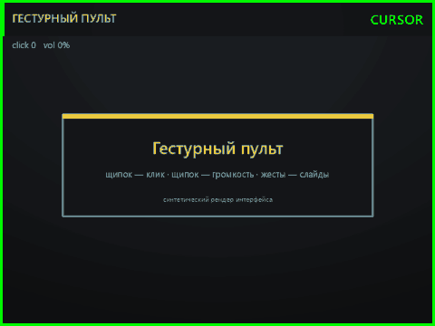
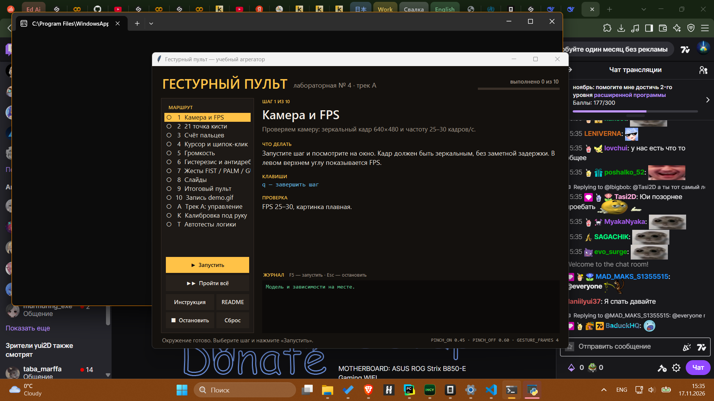

# Gesture Pult — управление компьютером жестами

[](https://www.python.org/)
[](https://ai.google.dev/edge/mediapipe/solutions/vision/hand_landmarker)
[](https://opencv.org/)
[](#ограничения)
[](LICENSE)

**Курсор, клики, прокрутка, громкость и слайды — жестами перед веб-камерой.**
21 точка кисти от MediaPipe Hand Landmarker, обработка на CPU (25–30 FPS),
управление системой через PyAutoGUI и pycaw. Без GPU, без обучения своей
модели и без облака — всё локально.

> **EN.** Control the desktop with hand gestures: cursor, click/drag, volume,
> slide navigation, plus right click, smooth scrolling and double click. Built
> with MediaPipe Hand Landmarker, OpenCV and PyAutoGUI; runs on CPU at
> ~30 FPS. Gesture recognition uses joint angles, hysteresis, EMA smoothing
> and N-frame confirmation; deterministic tests replay synthetic hands, so no
> camera or real clicks are needed.



*Синтетический рендер интерфейса: `demo_render.py` подаёт кисть из
`hand_model.py` в настоящие функции проекта, а PyAutoGUI заменён заглушкой.
Так сценарий воспроизводится детерминированно и без кликов по рабочему столу.
Ниже — как записать ролик с живой рукой.*

## Что умеет

- **Курсор** следует за кистью с EMA-сглаживанием и «мёртвой зоной» 2 px —
  без дрожания и микродвижений.
- **Левая кнопка** — щипок большой + указательный; удержание дольше 0.3 с
  превращается в перетаскивание. В кулаке клик заблокирован.
- **Громкость** — раствор щипка (сомкнули — тише, развели — громче),
  с шагом 2 %, чтобы не дёргать микшер на каждый кадр.
- **Слайды** — ладонь листает вперёд, «пистолет» назад, один раз за удержание.
- **Трек A:** правый клик, прокрутка колесом и двойной клик с защитой от
  конфликтов (см. ниже).
- **Калибровка** порогов под свою руку за 6 секунд.
- **Графический пульт** для запуска всех этапов и инструкций по шагам.
- **Автотесты** логики без камеры: жесты, дребезг, клики, прокрутка.

## Как это работает

```text
веб-камера 640×480
      │  кадр, зеркальное отражение
      ▼
MediaPipe Hand Landmarker (VIDEO, CPU)  ──►  21 точка кисти
      │
      ▼
признаки: углы в суставах PIP, расстояния, нормировка на размер кисти
      │
      ▼
устойчивость: гистерезис → EMA → «мёртвая зона» → подтверждение N кадров
      │
      ▼
PyAutoGUI (мышь, клавиши) · pycaw (громкость Windows)
```

Что делает распознавание устойчивым:

- **Углы вместо координат.** Жест `FIST / PALM / GUN` определяется по углу
  в суставе PIP, поэтому не зависит от поворота и наклона кисти.
- **Гистерезис.** Щипок включается при 0.45 и выключается при 0.60 от
  размера кисти — граница не «мигает».
- **Подтверждение кадрами.** Жест срабатывает, только если продержался
  4 кадра подряд (`GESTURE_FRAMES`); смена режима — после 40 кадров
  удержания кулака.
- **Нормировка на масштаб.** Все пороги считаются в долях размера кисти,
  поэтому работают и у камеры, и на расстоянии вытянутой руки.
- **Защиты от конфликтов.** Пока активен правый щипок, левый игнорируется;
  прокрутка требует отведённого большого пальца; в кулаке курсор замирает.

## Быстрый старт

```powershell
git clone https://github.com/Ypsidshi/Gesture-pult-CV-project.git
cd Gesture-pult-CV-project

python -m venv venv
venv\Scripts\Activate.ps1
python -m pip install -r requirements.txt

python step_02_landmarks.py     # камера + скелет кисти
python gesture_hub.py           # графический пульт со всеми шагами
```

Модель `models/hand_landmarker.task` (7,5 МБ) уже в репозитории. Если её нет:

```powershell
Invoke-WebRequest `
  https://storage.googleapis.com/mediapipe-models/hand_landmarker/hand_landmarker/float16/1/hand_landmarker.task `
  -OutFile models\hand_landmarker.task
```

Проверено на Windows 11, Python 3.14.7, mediapipe 1.2.3, OpenCV 5.0.0,
numpy 2.5.3. Нужен Python 3.10+.

## Жесты и режимы

| Жест | Действие | Режим |
|---|---|---|
| Кисть перед камерой | курсор следует за точкой 5 | `CURSOR` |
| Щипок большой + указательный | ЛКМ; удержание > 0.3 с — перетаскивание | `CURSOR` |
| Кулак, удержанный 40 кадров | следующий режим | любой |
| Раствор щипка | уровень громкости | `VOLUME` |
| Ладонь / «пистолет» | слайд вперёд / назад | `SLIDES` |
| Щипок большой + средний | правый клик | `CONTROL` |
| Указательный + средний, движение вверх/вниз | прокрутка колесом | `CONTROL` |
| Два щипка быстрее 0.45 с | двойной клик | `CONTROL` |

Режимы также переключаются клавишами `1`–`3` (в треке A — `1`–`4`),
`q` — выход, `r` — запись `demo.gif`.

### Трек A: мышь целиком

`python track_A_control.py` → клавиша `2` (режим `CONTROL`).

| Действие | Как | Реализация |
|---|---|---|
| Правый клик | щипок большой + средний (точки 4 и 12) | `click(button="right")`, гистерезис 0.50/0.65, пауза 0.35 с |
| Прокрутка | два выпрямленных пальца, кисть вверх/вниз | `scroll`, шаг 0.015 кадра, 3 строки, пауза 0.10 с |
| Двойной клик | два щипка быстрее 0.45 с | одиночный клик отложен; второй щипок отменяет его и вызывает `doubleClick()` |
| Одиночный клик | один короткий щипок | `click()` после окна ожидания 0.45 с |
| Перетаскивание | щипок дольше 0.30 с | `mouseDown()` … `mouseUp()` |

Защиты: правый щипок блокирует левый; после правого клика левая кнопка
заблокирована на 1,2 с; если большой палец ближе к среднему, чем к
указательному, это правый щипок; прокрутка не двигает курсор; отложенный
одиночный клик не даёт тройного клика.

## Пульт



`gesture_hub.py` — окно на Tkinter, которое запускает шаги по очереди:

- слева маршрут: шаги 1–10, трек A, калибровка, автотесты;
- справа инструкция к выбранному шагу и журнал вывода;
- **«Запустить»** / `F5` — текущий шаг, **«Пройти всё»** — шаги 1–10 подряд;
- **«Остановить»** / `Esc` — закрыть процесс, **«Сброс»** — снять отметки;
- прогресс хранится в `hub_state.json`, шаг отмечается `✓` после выхода по `q`.

В Windows пульт открывается двойным щелчком по `start_hub.bat`.
Шаги 4, 5, 8, 9 управляют реальной мышью, громкостью и клавишами —
перед автопрогоном закройте лишние окна.

## Пороги и как они подобраны

| Параметр | Значение | Замер / причина |
|---|---|---|
| `PINCH_ON` / `PINCH_OFF` | 0.45 / 0.60 | сомкнутый щипок 0.09, разведённый 1.32 — пороги с запасом |
| `GESTURE_FRAMES` | 4 | 1 кадр → 5 срабатываний (ловит переходный `GUN`), 4 → 4, 50 → 0 |
| `FIST_HOLD` | 40 кадров (~1,3 с) | при 8 кадрах случайное сжатие кисти меняло режим |
| `ALPHA` / `DEAD_ZONE` | 0.4 / 2 px | дрожание курсора убрано, задержка не ощущается |
| гистерезис щипка | — | 600 кадров: 25 переключений у одного порога против 3 у гистерезиса |
| `RIGHT_ON` / `RIGHT_OFF` | 0.50 / 0.65 | правый щипок не пересекается с левым |
| `DOUBLE_MS` | 0.45 с | окно двойного клика; одиночный ждёт столько же |
| `SCROLL_STEP` | 0.015 кадра | ~3 строки за щелчок колеса без «разгона» |

Пороги лежат в начале `common.py` и `track_A_control.py`, обоснование —
в отчёте. Под свою руку их пересчитывает `python calibrate_pinch.py`: 3 с
сомкнутого щипка, 3 с разведённого, готовые строки для `common.py`.

## Структура проекта

```text
.
├─ common.py                  # камера, MediaPipe, признаки, курсор, громкость, пороги
├─ step_01_camera.py          # 1. камера и FPS
├─ step_02_landmarks.py       # 2. 21 точка и скелет
├─ step_03_fingers.py         # 3. счёт выпрямленных пальцев
├─ step_04_cursor.py          # 4. курсор, щипок-клик, перетаскивание
├─ step_05_volume.py          # 5. режимы IDLE / VOLUME / CURSOR
├─ step_06_debounce.py        # 6. дребезг: один порог против гистерезиса
├─ step_07_gestures.py        # 7. FIST / PALM / GUN
├─ step_08_slides.py          # 8. жесты → клавиши презентации
├─ step_09_final.py           # 9. итоговый пульт
├─ step_10_demo.py            # 10. итоговый пульт + запись demo.gif
├─ track_A_control.py         # трек A: ПКМ, прокрутка, двойной клик
├─ gesture_hub.py             # графический пульт (Tkinter)
├─ start_hub.bat              # запуск пульта двойным щелчком
├─ calibrate_pinch.py         # калибровка порогов под руку
├─ hand_model.py              # синтетическая кисть для демо и тестов
├─ demo_render.py             # сборка demo.gif и screenshots/
├─ tests/test_logic.py        # автопроверки без камеры и кликов
├─ models/hand_landmarker.task
├─ screenshots/               # кадры интерфейса
├─ Отчет_ЛР4.md / .docx       # отчёт с замерами и обоснованием
├─ requirements.txt
└─ pyproject.toml             # метаданные и настройки Ruff
```

## Тесты

```powershell
python tests\test_logic.py
```

Скрипт подменяет PyAutoGUI заглушкой и прогоняет сценарии на синтетической
кисти: геометрия жестов, дребезг (25 переключений против 3), `GESTURE_FRAMES`
1/4/50 (5/4/0 срабатываний), курсор, правый клик, одиночный и двойной клик,
перетаскивание, прокрутка. Камера и реальные клики не используются,
результат пишется в `tests/test_report.txt`.

Линтер:

```powershell
python -m ruff check .
```

## Ограничения

- Системная громкость через `pycaw` работает в Windows; для macOS и Linux
  в `common.set_volume` есть ветки `osascript` / `pactl`, но они не тестировались.
- `demo.gif` в репозитории — синтетический рендер (честно подписан на кадре).
  Ролик с живой рукой: `python step_10_demo.py` → `r` → сценарий 20–30 с → `r`.
- Одна рука в кадре, без оценки глубины: жесты лучше показывать на фоне
  без других рук и лиц.
- FPS зависит от CPU и разрешения камеры; на ноутбуке — 25–30 кадров/с.

## Что можно улучшить

- Записать реальный `demo.gif` и короткое видео-демо.
- Добавить сглаживание One Euro вместо EMA для более точного курсора.
- Поддержка двух рук и жестов «свайп», «щипок двумя руками».
- CI с прогоном `tests/test_logic.py` в headless-режиме.
- Настройки порогов в графическом окне вместо правки `common.py`.

## Лицензия

MIT — см. [LICENSE](LICENSE).

Учебный проект: лабораторная работа № 4 «Гестурный пульт» (экспертные
системы). Отчёт с методикой, замерами и скриншотами — в
[Отчет_ЛР4.md](Отчет_ЛР4.md).
