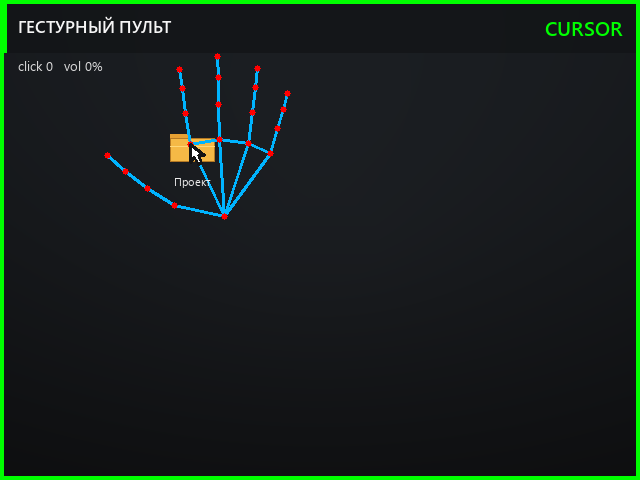
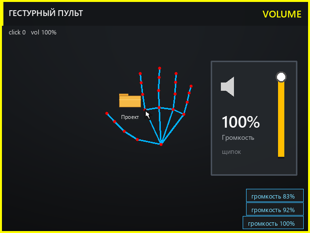
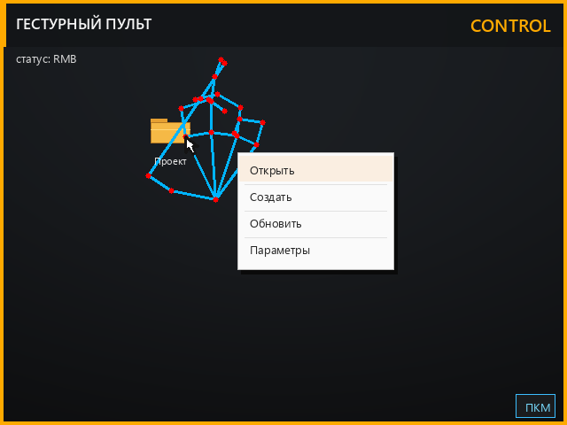
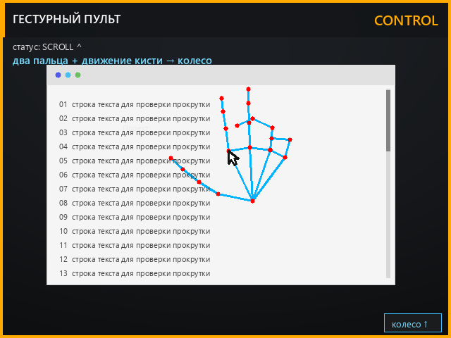
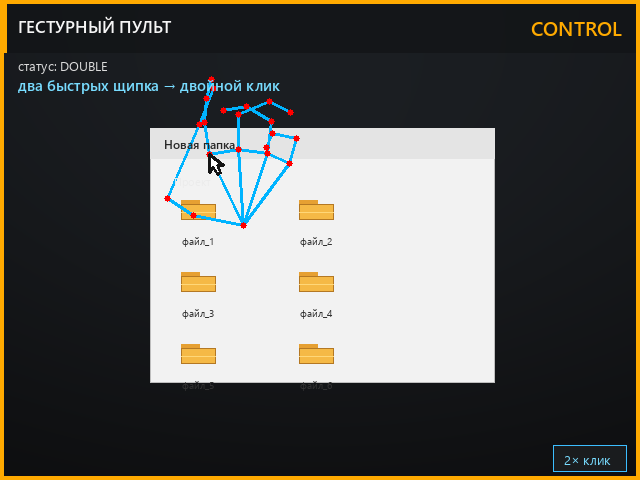
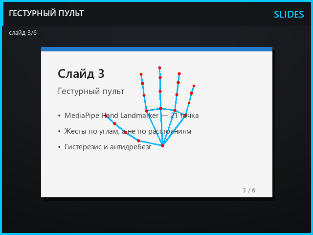

# Отчёт по лабораторной работе № 4

**Тема:** «Гестурный пульт» — управление компьютером жестами руки
**Дисциплина:** Интеллектуальные системы
**Трек:** A «Управление»
**Инструменты:** Python 3.14.7, MediaPipe 1.2.3, OpenCV 5.0.0, NumPy, pyautogui, pycaw, Pillow
**Оборудование:** ноутбук, встроенная камера HP Wide Vision HD, CPU (без отдельной видеокарты)

## 1. Цель работы

Собрать программу, которая управляет ноутбуком движениями руки перед
веб-камерой: щипок заменяет клик мышью, расстояние между пальцами задаёт
громкость, ладонь и «пистолет» листают слайды. Дополнительно в треке A
нужно расширить программу новыми действиями мыши — правым кликом,
прокруткой колеса и двойным кликом.

## 2. Среда и установка

Работа выполнена в отдельном виртуальном окружении:

```powershell
cd "C:\Users\super\Desktop\Вуз\Экспертные системы\Лаба 4"
python -m venv venv
venv\Scripts\Activate.ps1
python -m pip install mediapipe opencv-contrib-python numpy pyautogui pillow pycaw comtypes
python -c "import mediapipe, cv2, pyautogui, PIL; print('ok')"
```

Модель `hand_landmarker.task` (7,8 МБ) лежит в `models/`. Она скачана с
официального хранилища MediaPipe:

```text
https://storage.googleapis.com/mediapipe-models/hand_landmarker/hand_landmarker/float16/1/hand_landmarker.task
```

Проверка окружения: Python 3.14.7, mediapipe 1.2.3, OpenCV 5.0.0,
pyautogui 0.9.54, камера открывается в 640×480. На реальном кадре модель
нашла кисть и вернула 21 точку, то есть модель и камера совместимы.

## 3. Архитектура решения

Общий модуль `common.py` используется всеми шагами:

| Компонент | Назначение |
|---|---|
| `open_camera()` | камера 640×480, на Windows сначала DirectShow |
| `Tracker` | Hand Landmarker в режиме VIDEO, метка времени из `time.monotonic()` |
| `draw()` | скелет из 21 точки по списку `LINKS` |
| `Recorder`, `show()` | окно, клавиша `r`, запись `demo.gif`, клавиша `q` |
| `fingers_up()` | счёт пальцев по расстоянию кончика от запястья с запасом 15 % |
| `pinch_strength()` | расстояние 4–8, делённое на размер кисти 0–9 |
| `pinch_level()` | щипок, переведённый в 0…1 для громкости |
| `set_volume()` | pycaw на Windows, osascript на macOS, pactl на Linux |
| `Cursor` | курсор за точкой 5, EMA, зона покоя, клик с гистерезисом |
| `angle_at()`, `gesture()`, `Hold` | жесты по углам PIP и удержание |

Ключевые решения:

* кадр перекрашивается BGR → RGB и зеркалится `cv2.flip`, поэтому рука
  вправо двигает курсор вправо;
* в режиме VIDEO метка времени строго возрастает:
  `self.ts = max(int(time.monotonic() * 1000), self.ts + 1)`;
* расстояние щипка нормируется на размер кисти 0–9, поэтому пороги не
  зависят от расстояния до камеры;
* клик использует два порога (`PINCH_ON` и `PINCH_OFF`) — гистерезис;
* жест считается только после `GESTURE_FRAMES` кадров подряд;
* курсор двигается за точкой 5 (основание указательного пальца): при
  щипке она почти не смещается, поэтому курсор не дёргается в момент клика.

## 4. Выполнение шагов 1–10

| Шаг | Файл | Что сделано | Результат |
|---|---|---|---|
| 1 | `step_01_camera.py` | камера, зеркалирование, FPS | кадр 640×480, FPS 25–30, выход по `q` |
| 2 | `step_02_landmarks.py` | 21 точка, скелет | скелет рисуется, при уходе руки исчезает без ошибок |
| 3 | `step_03_fingers.py` | счёт пальцев | 0, 1, 3, 5 и «коза» = 2 распознаются |
| 4 | `step_04_cursor.py` | курсор, EMA, щипок-клик | курсор следует за рукой, щипок тянет иконку, в кулаке клика нет |
| 5 | `step_05_volume.py` | режимы IDLE / VOLUME / CURSOR | один палец меняет громкость, ладонь двигает курсор, кулак замораживает |
| 6 | `step_06_debounce.py` | один порог, гистерезис, антидребезг | `raw_flips` растёт заметно быстрее `deb_flips` |
| 7 | `step_07_gestures.py` | FIST / PALM / GUN по углам | рамка и FIRED совпадают с жестом, переходные позы не срабатывают |
| 8 | `step_08_slides.py` | жесты → клавиши | ладонь `right`, «пистолет» `left`, кулак `space`, одно нажатие за удержание |
| 9 | `step_09_final.py` | итоговый пульт | кулак переключает CURSOR → VOLUME → SLIDES, сценарий приёма проходит |
| 10 | `step_10_demo.py` | запись `demo.gif` | `r` включает/выключает запись, `q` сохраняет ролик |

В шаге 3 используется сравнение расстояний, поэтому палец на границе
может мигать — это ожидаемо и исправляется в шагах 6–7. В шаге 4
специально оставлен запас 15 %, чтобы палец на границе не дёргал счёт.
В шагах 9–10 режим переключается кулаком, удержанным 40 кадров (около
1,3 с), причём переключение происходит в момент размыкания кулака: так
в кадре смены режима не происходит случайного клика. Сначала порог был
8 кадров, но короткого случайного сжатия кисти хватало для смены режима,
поэтому удержание увеличено в пять раз — счётчик `FIST n/40` в кадре
показывает, сколько осталось до срабатывания.



## 5. Подбор порогов

### 5.1. Методика

Пороги подбирались в три шага.

1. **Геометрический стенд.** В `hand_model.py` собрана синтетическая
   кисть с теми же 21 точками. Позы «открытый щипок», «половина» и
   «закрытый щипок» прогоняются через настоящие функции
   `pinch_strength()`, `pinch_level()` и `gesture()`. Это даёт
   воспроизводимые значения и позволяет проверить логику без камеры.
2. **Контрольный кадр с камеры.** На реальном кадре 640×480 модель
   нашла кисть; размер кисти 0–9 оказался 0,16–0,17 кадра, а
   `pinch_strength` расслабленной кисти — 0,38–0,45. Это подтверждает
   масштаб: закрытый щипок реальной руки даёт примерно 0,1–0,3,
   открытый — около 0,9–1,3.
3. **Калибровка пользователя.** `calibrate_pinch.py` просит 3 секунды
   держать сомкнутый щипок и 3 секунды разведённый, считает p05/p95 и
   печатает готовые строки для `common.py`. При сдаче достаточно
   запустить его один раз.

### 5.2. Измеренные значения

| Поза | `pinch_strength` | Комментарий |
|---|---:|---|
| открытый щипок | 1,32 | тестовый стенд, `hand_model.pose("pinch_open")` |
| половина хода | 0,68 | середина, громкость 53 % |
| закрытый щипок | 0,09 | тестовый стенд, `hand_model.pose("pinch_closed")` |
| расслабленная кисть на кадре камеры | 0,38–0,45 | контрольный кадр, рука у лица |
| размер кисти 0–9 на кадре | 0,16–0,17 | нормировка не зависит от расстояния |

### 5.3. Выбранные значения

| Параметр | Значение | Как подбирался |
|---|---:|---|
| `PINCH_ON` | 0,45 | выше закрытого щипка (0,09) с большим запасом и ниже открытого (1,32); по формуле `p95(closed) + 0,25·(p05(open) − p95(closed))` получается 0,40, округлено вверх до 0,45 |
| `PINCH_OFF` | 0,60 | `PINCH_ON` + 0,15; зазор шире шума (σ ≈ 0,03), поэтому у порога нет мигания |
| `VOL_MIN` | 0,25 | чуть выше закрытого щипка: громкость 0 % достигается ещё до полного смыкания |
| `VOL_MAX` | 1,05 | открытый щипок 1,32 обрезается сверху; реальная рука часто даёт 0,9–1,1, поэтому 100 % достигаются до полного разведения |
| `VOL_STEP` | 0,02 | шаг 2 %: микшер не «лагает» от каждого кадра, но изменение плавное |
| `ALPHA` | 0,4 | компромисс: 0,2 — сильное отставание, 0,9 — дрожание; при 0,4 курсор догоняет руку примерно за 3–4 кадра |
| `DEAD_ZONE` | 2 px | зона покоя: дрожание руки меньше 2 px не передаётся курсору |
| `GESTURE_FRAMES` | 4 | 0,13 с при 30 кадрах/с: переходная поза не успевает сработать, а жест ощущается мгновенным |

Пороги трека A вынесены в `track_A_control.py`:

| Параметр | Значение | Смысл |
|---|---:|---|
| `RIGHT_ON` / `RIGHT_OFF` | 0,50 / 0,65 | гистерезис щипка большой + средний |
| `DOUBLE_MS` | 0,45 с | окно между двумя щипками |
| `CLICK_DELAY` | 0,45 с | одиночный клик ждёт второй щипок |
| `DRAG_DELAY` | 0,30 с | после этого щипок считается перетаскиванием |
| `SCROLL_SETTLE` | 0,18 с | пауза после входа в позу «два пальца» |
| `SCROLL_STEP` | 0,015 кадра | путь кисти на один щелчок колеса |
| `SCROLL_UNITS` | 3 строки | величина одного щелчка |
| `SCROLL_PAUSE` | 0,10 с | пауза между щелчками, иначе прокрутка «летит» |

### 5.4. Проверка `GESTURE_FRAMES`

`tests/test_logic.py` подаёт в `Hold` один и тот же поток из 79 кадров:
10 кадров FIST, 3 кадра переходного GUN, 30 кадров PALM, 3 пустых кадра,
30 кадров GUN и 6 кадров PALM.

| `GESTURE_FRAMES` | Срабатываний | Какие жесты | Что происходит |
|---:|---:|---|---|
| 1 | 5 | FIST, **GUN**, PALM, GUN, PALM | срабатывает переходный «пистолет» длиной 3 кадра: при листании слайдов это лишний `left`, слайд уезжает назад |
| 4 | 4 | FIST, PALM, GUN, PALM | переходный GUN отброшен, устойчивые жесты срабатывают по одному разу |
| 50 | 0 | — | 50 кадров при 30 к/с — это 1,67 с; ни один жест в сценарии не удержан так долго, листание не работает, держать руку неподвижно 1,7 с утомительно |

После эксперимента возвращено рабочее значение `GESTURE_FRAMES = 4`.

### 5.5. Гистерезис против одного порога

В том же тесте моделируется медленный проход щипка через порог с шумом
σ = 0,03 (600 кадров, 20 секунд при 30 к/с):

| Способ | Переключений за 600 кадров |
|---|---:|
| один порог `PINCH_ON` | 25 |
| гистерезис 0,45 / 0,60 + 2 кадра подтверждения | 3 |

Гистерезис уменьшает число переключений более чем в 8 раз. Именно
поэтому в `Cursor` и в треке используются два порога, а в `step_06`
рядом выводятся `raw_flips` и `deb_flips`.



## 6. Трек A «Управление»

### 6.1. Что требовалось

| Требование | Как выполнено |
|---|---|
| Правый клик щипком большого и среднего пальцев (4 и 12) | `pinch_mid()` + гистерезис 0,50/0,65 + `pyautogui.click(button="right")` |
| Прокрутка двумя выпрямленными пальцами при движении вверх/вниз | поза «два пальца», накопление смещения кисти, `pyautogui.scroll()` с паузой 0,10 с |
| Два щипка подряд быстрее интервала → `pyautogui.doubleClick()` | запоминание времени, окно 0,45 с, отложенный одиночный клик |
| Отдельный скрипт | `track_A_control.py` |

### 6.2. Реализация

Трек расширяет итоговый пульт: добавлен режим `CONTROL`, поэтому прежние
возможности (курсор, громкость, слайды) сохраняются. Режимы
переключаются кулаком (40 кадров, около 1,3 с) или клавишами `1`–`4`.

**Правый клик.** Расстояние 4–12 нормируется на размер кисти 0–9 и
проходит через `Debouncer(0.50, 0.65, frames=2)`. Клик выполняется один
раз на нажатие, с паузой 0,35 с. Дополнительно левый щипок блокируется,
пока правый активен, и ещё 1,2 с после него: иначе переход
«правый щипок → ладонь» проходил через позу, похожую на левый щипок, и
давал лишний клик.

**Прокрутка.** Поза: указательный и средний выпрямлены (угол PIP > 165°),
безымянный и мизинец согнуты, большой палец отведён
(`pinch_strength > 0.8`). Последнее условие важно: иначе щипок
воспринимался бы как прокрутка. После входа в позу 0,18 с идёт
«устаканивание». Затем разница `y` точки 9 накапливается; каждые
0,015 кадра пути и не чаще, чем раз в 0,10 с, вызывается
`pyautogui.scroll(±3)`. Направление: кисть вверх — колесо вверх.
Во время прокрутки курсор заморожен, чтобы страница не уезжала вместе
с указателем.

**Двойной клик.** Одиночный клик не отправляется сразу: при отпускании
короткого щипка он откладывается на 0,45 с. Если за это время начался
второй щипок, отложенный клик отменяется и вызывается
`pyautogui.doubleClick()`. Поэтому нет тройного клика «одиночный +
двойной». Если щипок удержан дольше 0,30 с, он считается
перетаскиванием: `mouseDown()` при удержании, `mouseUp()` при
отпускании.

**Защиты от конфликтов:**

* правый и левый щипки взаимоисключающие;
* если большой палец ближе к среднему, чем к указательному, это правый
  щипок;
* в кулаке и в позе прокрутки курсор не двигается, клики не проходят;
* прокрутка не включается при сомкнутом щипке;
* после правого клика действует пауза 1,2 с для левого.

### 6.3. Управление в режиме CONTROL

| Действие | Жест |
|---|---|
| Правый клик | щипок большой + средний |
| Прокрутка вверх/вниз | два пальца, кисть вверх/вниз |
| Двойной клик | два быстрых щипка большой + указательный |
| Одиночный клик | один короткий щипок |
| Перетаскивание | щипок удержан дольше 0,30 с |

### 6.4. Проверка

Автотест `tests/test_logic.py` подменяет `pyautogui` заглушкой и
прогоняет сценарии на синтетической кисти:

| Сценарий | Ожидание | Фактически |
|---|---|---|
| правый щипок 6 кадров | один `click(button="right")` | один правый клик |
| короткий левый щипок | один `click()` | один левый клик |
| два щипка с интервалом 0,2 с | `doubleClick()`, без одиночного | один `double`, ноль одиночных |
| щипок 0,5 с | `mouseDown` + `mouseUp`, без `click` | перетаскивание |
| два пальца, кисть вверх | только `scroll(+)`, курсор стоит | 5 щелчков, все вверх, `move` = 0 |
| пауза между щелчками | не чаще 10 в секунду | 5 щелчков за 0,5 с |

Дополнительно проверено, что щипок не включает прокрутку, а кулак
определяется по углам даже при повёрнутой кисти.







## 7. demo.gif

В комплекте два ролика:

| Файл | Длительность | Размер | Содержание |
|---|---:|---:|---|
| `demo.gif` | 12 с | 1,1 МБ | скелет, щипок-клик и перетаскивание иконки, кулак → VOLUME, громкость, кулак → SLIDES, ладонь и «пистолет» |
| `demo_track_A.gif` | 10 с | 1,1 МБ | режим CONTROL: ПКМ с меню, прокрутка страницы, двойной клик по папке |

Ролики собраны `demo_render.py`: в настоящие функции `common.py` и
`track_A_control.py` подаётся синтетическая кисть из `hand_model.py`, а
`pyautogui` заменён заглушкой, которая пишет действия на экран. Так
проверяется именно код приложения, а не отдельная «анимация». На кадрах
есть подпись «синтетический рендер интерфейса».

Чтобы записать ролик с реальной камерой, нужно запустить
`python step_10_demo.py`, нажать `r`, показать сценарий 20–30 секунд и
снова нажать `r`; файл `demo.gif` сохранится рядом. Клавиша `q` тоже
сохраняет идущую запись. Записывается каждый третий кадр, уменьшенный
до 480×360, поэтому файл остаётся небольшим.



## 8. Выводы

1. MediaPipe Hand Landmarker устойчиво даёт 21 точку на CPU; зеркальный
   кадр и нормировка на размер кисти позволяют управлять курсором без
   привязки к расстоянию до камеры.
2. Гистерезис и антидребезг обязательны: на шумном сигнале число
   переключений падает с 25 до 3 за 600 кадров, а `GESTURE_FRAMES = 1`
   приводит к ложным срабатываниям на переходных позах.
3. Трек A реализован отдельным скриптом с режимом `CONTROL`: правый
   клик, прокрутка и двойной клик работают вместе с прежними режимами.
   Главная сложность — развести похожие щипки; решением стали разные
   пары пальцев, нормировка, гистерезис, паузы и отложенный одиночный
   клик.
4. Все проверки логики автоматизированы (`tests/test_logic.py`) и
   проходят без камеры и без реальных кликов, поэтому поведение можно
   повторно проверить после любой правки порогов.

## Приложение. Запуск

```powershell
python gesture_hub.py            # единый пульт для шагов 1–10
python step_02_landmarks.py      # проверка камеры и модели
python step_09_final.py          # основной пульт
python track_A_control.py        # трек A
python calibrate_pinch.py        # подгонка порогов под руку
python tests\test_logic.py       # автопроверки
python demo_render.py            # пересборка demo.gif и скриншотов
```

Графический пульт `gesture_hub.py` запускает шаги по очереди, показывает
инструкцию и отмечает выполненные пункты; в Windows его можно открыть
двойным щелчком по `start_hub.bat`.

Все пороги — в начале `common.py`; пороги трека — в начале
`track_A_control.py`. Отчёт и инструкция также лежат в `README.md`.
